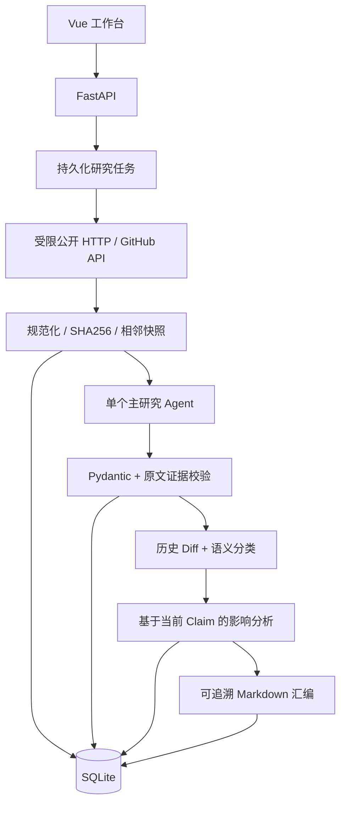

# 架构与数据约束

Product → Source → Snapshot；Claim 必须关联 Snapshot 和 Product；ChangeEvent 必须关联两个真实历史 Snapshot。ImpactAnalysis 关联目标产品、竞争产品及 ChangeEvent；JSON 结构中包含审阅关系、证据 ID、机会、风险、建议与未知。Report 冻结 Markdown 和 Claim ID，历史证据不会随来源停用删除。

快照仅在与**相邻**版本不同才写入；(source_id, sequence) 唯一。允许 A→B→A 的真实回退，避免永久按内容 Hash 去重破坏历史。变化版本对唯一。首次版本不会进入变化检测。任务存盘后异步执行，每来源独立错误边界，进程重启将 unfinished 标记 interrupted。单 worker 是部署约束。

网页是纯文本不可信数据；模型没有网络、文件系统、密钥读取或外部修改工具，只提供政策 Function Tool。结构化调用在受控 Python 流程的固定阶段发生，每个阶段使用同一主 Agent 策略与输出 Schema。官方 Responses 和 Chat 走 Agents SDK，弱兼容端点用独立 JSON 适配；失败不降级到编造事实。

安全：拒绝私网和非标准协议/端口，解析所有 DNS 结果后验证并固定到公网 IP，TLS 保持原始主机 SNI。每个重定向重新验证、不继承凭据。robots 不可读取时保守失败（404 视为无规则）。同源跳转后采集仍保存最终 URL；跨源跳转额外校验新域 robots。生产环境仍建议增加独立出网防火墙。

UTC ISO8601 时间；SQLite 外键开启，迁移保留通用 SQLAlchemy 类型。对比只选择每个活跃来源当前快照中的 verified Claim，避免旧证据覆盖新状态。同维度冲突不会按多数投票抹除。验证只涵盖证据存在与保守状态限制，不宣称已经完成独立事实核查。
